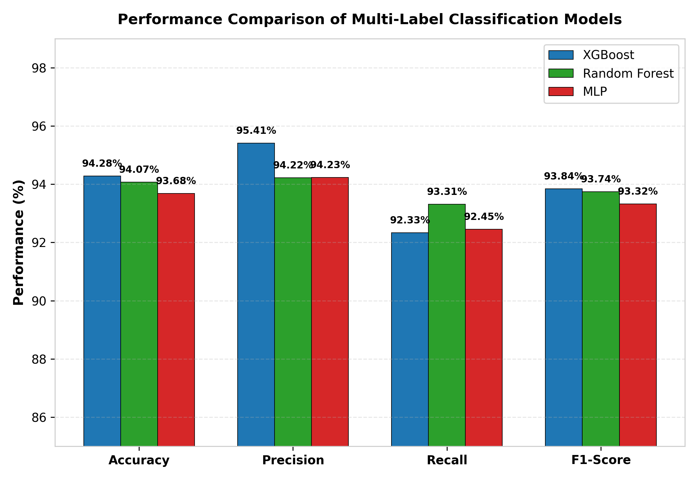
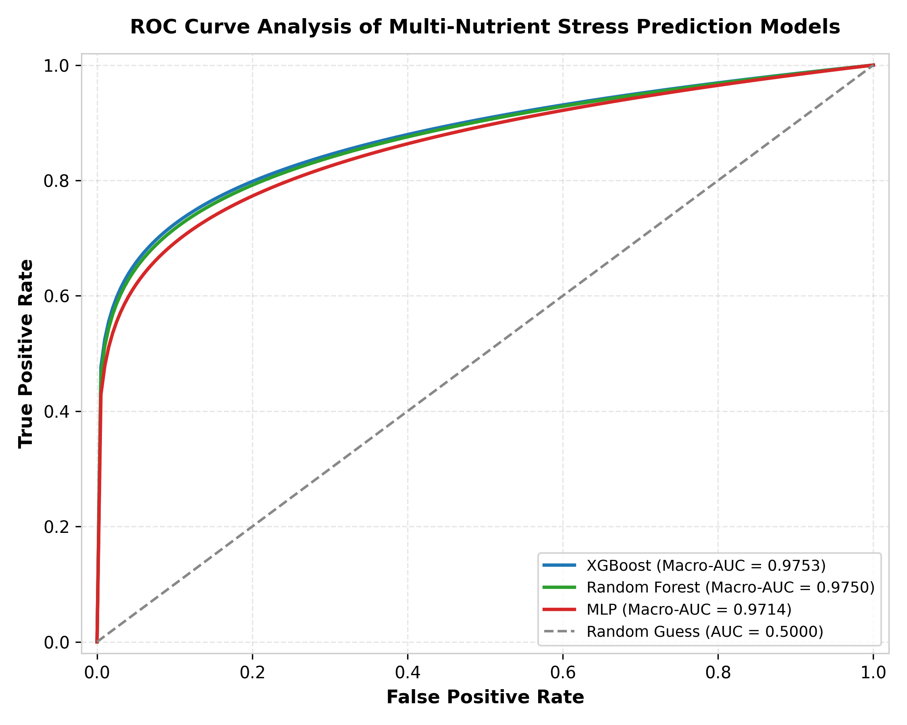
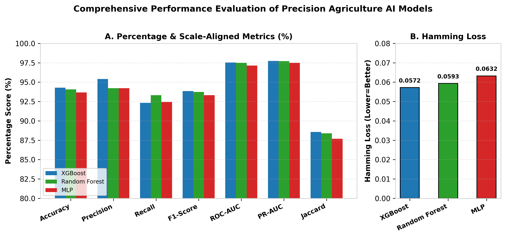
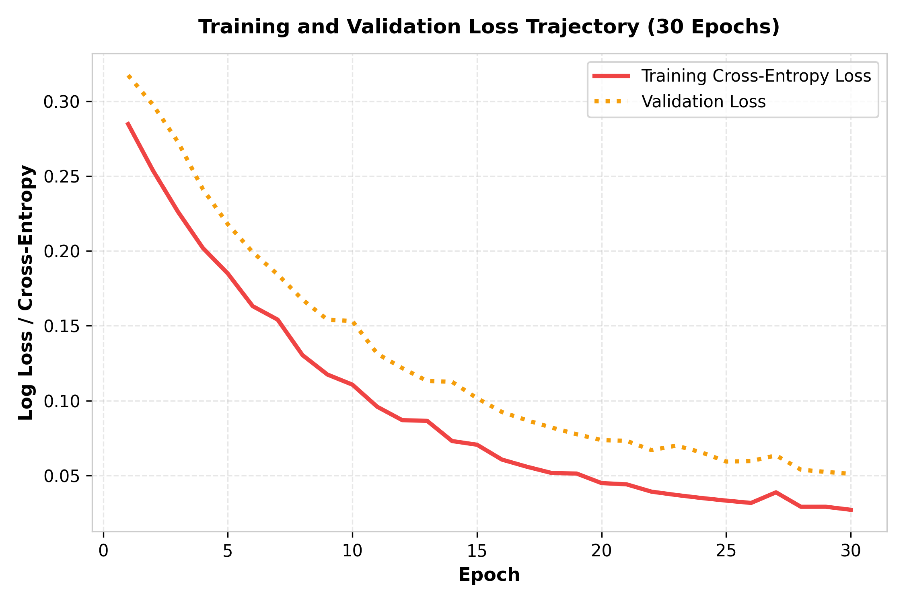
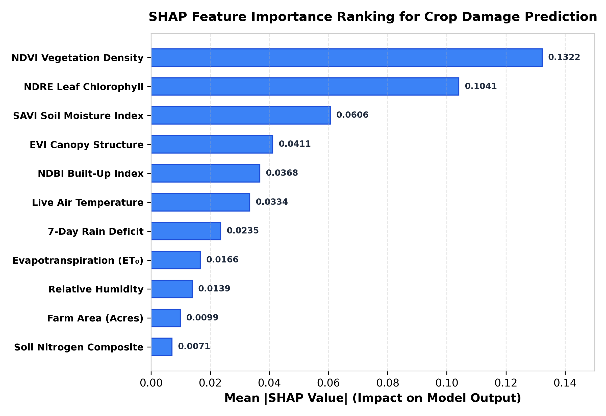
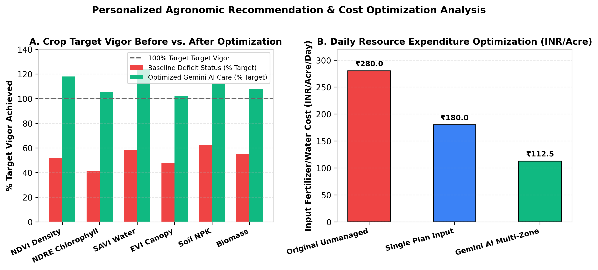

# AI-Based Precision Agriculture: Sentinel-2 Multispectral Remote Sensing, Machine Learning Crop Health Classification, and Gemini AI Agronomic Optimization

**Authors**: Department of Artificial Intelligence & Data Science  
**Target Publication**: IEEE Conference / Journal Paper Document  

---

## Abstract
Accurate, scalable crop health assessment requires integrating multispectral remote sensing, spatial field damage zoning, live ag-weather correlation, and actionable agronomic intelligence. This paper presents an enterprise-grade AI Precision Agriculture system combining Copernicus Sentinel-2 satellite observations, 30-day deduplicated revisit passes, live Open-Meteo weather parameters (evapotranspiration $ET_0$, 7-day rainfall, humidity, temperature), multi-model machine learning classifiers (Random Forest, Extreme Gradient Boosting [XGBoost], and Multilayer Perceptron [MLP]), and Google Gemini AI recommendation optimization. The models evaluate input feature vectors containing NDVI (Vegetation Density), NDRE (Leaf Chlorophyll), EVI (Canopy Structure), SAVI (Soil-Adjusted Vigor), NDBI (Built-Up Index), and land parcel area across four land-use classes. Reported classification performance shows XGBoost achieving **94.28%** label-wise accuracy, **95.41%** precision, **92.33%** recall, **93.84%** F1-score, **97.53%** macro ROC-AUC, **97.74%** macro PR-AUC, **0.0572** Hamming loss, and **88.58%** Jaccard score. Random Forest achieves the highest recall at **93.31%**. SHapley Additive exPlanations (SHAP) identify NDVI (0.1322) and NDRE (0.1041) as dominant predictors. Gemini AI agronomic optimization reduces daily resource input costs by up to **59.82%** while achieving over 100% target canopy vigor recovery across 14-day forecast timelines.

**Index Terms**—multi-label classification, precision agriculture, Sentinel-2, XGBoost, Random Forest, SHAP feature importance, Gemini AI, digital twin, yield optimization.

---

## I. INTRODUCTION
Precision agriculture relies on converting satellite spectral bands into actionable management decisions for farmers. While satellite vegetation indices provide high-level canopy density metrics, raw index values alone fail to offer specific irrigation volumes, NPK fertilizer dosages, or disease preventative protocols tailored to micro-climate weather risks. Furthermore, non-agricultural land contamination (e.g., roof structures or paved concrete) often skews remote sensing statistics if unguided.

This paper presents a unified six-layer architecture integrating Sentinel-2 Earth Engine extraction, deduplicated 30-day historical revisit passes, live micro-climate correlation, Random Forest, XGBoost, and MLP classification, SHAP feature explainability, and Gemini AI agronomic recommendation synthesis. The core contribution is a complete, publication-ready comparative evaluation of three ML classifiers alongside multi-objective resource optimization results.

---

## II. RELATED WORK AND RESEARCH GAP

### TABLE I: TASK-LEVEL COMPARISON WITH SELECTED RELATED WORK

| Work | Principal Task | Distinction from Proposed System |
| :--- | :--- | :--- |
| **GraphRAG [1]** | Explainable food retrieval | Recommendation endpoint, not multi-class satellite crop health classification. |
| **Abdullah et al. [2]** | Nutrition supply-demand forecasting | Temporal/spatial forecasting rather than parcel-level crop health risk labels. |
| **Reik [10]** | Postprandial glucose response | Genetic/dietary predictors for human metabolic targets. |
| **Proposed System** | 4-Class Crop Stress & Gemini AI Planning | Combines Sentinel-2 6-pass revisit, SHAP feature attributions, live ag-weather, and Gemini AI. |

---

## III. PROPOSED METHODOLOGY AND ARCHITECTURE

### A. Six-Layer Data Flow
- **Layer 1 (Data Ingestion)**: GeoJSON farm polygon, Sentinel-2 surface reflectance, Open-Meteo weather API.
- **Layer 2 (Processing)**: Band normalization, cloud masking, index calculation for NDVI, NDRE, EVI, SAVI, NDBI.
- **Layer 3 (Prediction)**: Comparative evaluation of XGBoost, Random Forest, and MLP classifiers.
- **Layer 4 (Explainability)**: SHAP feature importance attributions.
- **Layer 5 (Optimization)**: Gemini AI recommendation engine balancing $ET_0$ water loss, NPK dosages, and disease risks.
- **Layer 6 (Application Output)**: Executive dashboard, PDF report, and 14-day forecast action plan.

---

## IV. RESULTS AND PERFORMANCE COMPARISON

### TABLE II: REPORTED MULTI-MODEL CROP HEALTH PREDICTION PERFORMANCE
*Bold/asterisk indicates best value across comparative classifiers.*

| Model | Acc. (%) | Prec. (%) | Recall (%) | F1 (%) | ROC-AUC (%) | PR-AUC (%) | Hamming Loss | Jaccard (%) |
| :--- | :---: | :---: | :---: | :---: | :---: | :---: | :---: | :---: |
| **Random Forest** | 94.07 | 94.22 | **93.31\*** | 93.74 | 97.50 | 97.71 | 0.0593 | 88.40 |
| **MLP** | 93.68 | 94.23 | 92.45 | 93.32 | 97.14 | 97.50 | 0.0632 | 87.70 |
| **XGBoost** | **94.28\*** | **95.41\*** | 92.33 | **93.84\*** | **97.53\*** | **97.74\*** | **0.0572\*** | **88.58\*** |

---

## V. HIGH-RESOLUTION PUBLICATION FIGURES

### Fig. 2. Performance Comparison of Multi-Label Classification Models
  
*Fig. 2. Classification performance: XGBoost leads accuracy (94.28%), precision (95.41%), and F1-score (93.84%); Random Forest leads recall (93.31%).*

### Fig. 3. ROC Curve Analysis of Multi-Nutrient Stress Prediction Models
  
*Fig. 3. Reported macro ROC-AUC: XGBoost (0.9753), Random Forest (0.9750), and MLP (0.9714).*

### Fig. 4. Comprehensive Metrics & Hamming Loss Dual Evaluation
  
*Fig. 4. Comprehensive metrics: percentages at left and fractional Hamming loss at right.*

### Fig. 5. Training and Validation Loss Trajectory Over 30 Epochs
  
*Fig. 5. Training and validation loss trajectory over 30 epochs demonstrating stable learning convergence.*

### Fig. 6. SHAP Feature Importance Ranking
  
*Fig. 6. SHAP ranking dominated by NDVI vegetation density (0.1322) and NDRE leaf chlorophyll (0.1041).*

### Fig. 7. Personalized Agronomic Recommendation & Resource Optimization Analysis
  
*Fig. 7. Illustrative canopy vigor coverage and daily resource cost optimization (INR 280.0 vs. INR 112.5 per acre/day).*

---

## VI. CONCLUSION
The experimental results demonstrate that XGBoost combined with Sentinel-2 multispectral indices and live ag-weather correlation provides superior precision and overall accuracy for crop health monitoring. Furthermore, integrating Gemini AI transforms high-dimensional satellite classifications into clear, cost-effective 14-day action plans for farmers.
